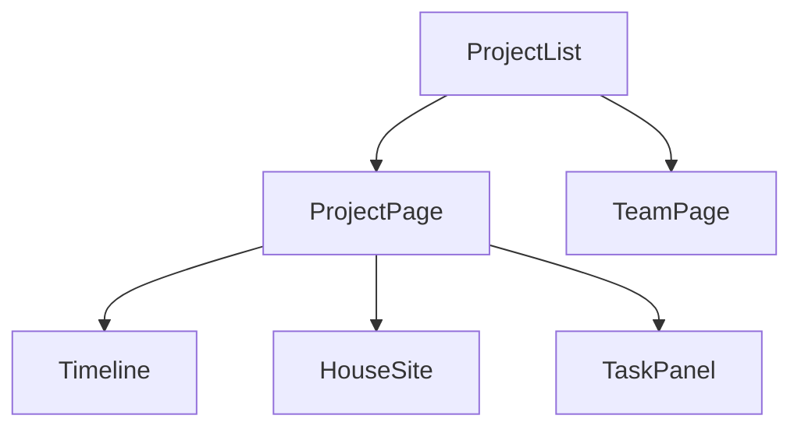
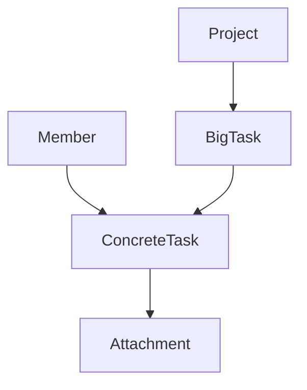

# 工地项目板

做一个团队内网使用的轻量项目管理应用：项目列表、成员花名册，以及每个项目里的时间轴和大任务。整个项目的完成度驱动画面中央一栋扁平插画房子的建造阶段。

界面标题用「工地」，全文中文。空仓库从零搭建。确认这份计划，就表示下面的产品决定已经锁定。

## 产品决定

- 一个团队、一份数据。成员在「团队」页维护（名字 + 代表色），任务里只能从花名册选择。无登录。修改即时写入数据库，刷新后其他人可见；同时改同一条时以后写为准。
- 首页是项目卡片：名称、开工到完工、完成百分比、一栋与当前阶段一致的小房子。没有项目时只显示创建入口。创建时填写名称、开工日、完工日，默认今天起 30 天。
- 项目页从上到下：顶栏（返回、项目名、开工完工日、周/月切换、团队入口）、时间轴、工地。右侧面板编辑，时间轴只负责选中和拖拽。按桌面宽屏设计，窄窗口时时间轴横向滚动。
- 只有两层。大任务有标题、起止日期、区分色。具体任务有标题、一位可选负责人、三态（未开始 / 进行中 / 完成）、可选附件，不能再拆，也不能改挂到别的大任务。
- 大任务必须有日期。周/月只改刻度，一周从周一开始，拖拽按天吸附，最短 1 天。重叠的大任务上下分行。拖出项目工期会自动延长项目；在顶栏把工期改到装不下已有任务时，修改不生效并提示。
- 「添加大任务」默认「未命名任务」，从今天起 7 天，并夹在项目工期里，随即打开面板。面板里「添加具体任务」默认「未命名事项」、未开始、未指派，立刻计入房子的分母。具体任务按添加顺序排列。
- 附件只在具体任务上，可有多条，名称和地址都可空，两个都空则不保存。只有名称时是纯文字。http(s) 新标签打开，其他路径点击后复制。不上传文件。
- 点工人：高亮他参与的大任务，其余变淡，再点取消。点工期条仍打开面板。房子不可点击。
- 项目、大任务、具体任务、成员、附件都可删除，先确认，确认后不可撤销。删大任务会带走具体任务。删成员只把相关任务改为未指派。
- 第一版不做：任务依赖、评论、通知、角色权限、工时、文件上传、自定义字段、手机版、实时光标、云部署。

## 进度与房子

房子和工人是分层扁平插画（SVG）。阶段切换约 300–400ms，系统开启减少动效时直接切到终态。全部完成时窗户亮灯。成员色只用在工人身上，大任务色只用在工期条上。

房子百分比只统计全部具体任务：`已完成数 / 总数`。进行中不算完成。空的大任务不进入分母。

- 没有具体任务，或完成数为 0：0%，空地
- 全部完成：100%，亮灯
- 其余：四舍五入到整数，并限制在 1–99。1–24 地基，25–49 框架，50–74 墙体和屋顶，75–99 门窗装修

工地旁显示未开始、进行中、已完成三个计数。有指派任务的成员站在房前，显示他自己的 `完成数/总数`；他一个都没完成时显示 0%。

## 技术与文件

跑在一台电脑上，浏览器通过局域网地址访问。Node 22+ 使用内置 `node:sqlite`（避免 Windows 上编译原生模块），React + TypeScript + Vite，开发时 Vite 把 `/api` 代理到 API，页面和接口同一来源。数据库文件放在 `data/app.sqlite`，不提交。

视觉在已锁定的扁平插画前提下，用工地色：纸色背景、墨色文字、安全橙作为强调色。中文用 Noto Sans SC。正文对比度至少 4.5:1，可点击元素有焦点态，图标用 SVG，不用 emoji。检索到的「3D / 避免纯二维」不采用，因为已经定为扁平插画。

主要新文件：

- [server/src/index.ts](../server/src/index.ts)、[server/src/db.ts](../server/src/db.ts)：建表、REST、监听 `0.0.0.0` 并打印局域网地址
- [client/src/pages/ProjectListPage.tsx](../client/src/pages/ProjectListPage.tsx)、[client/src/pages/TeamPage.tsx](../client/src/pages/TeamPage.tsx)、[client/src/pages/ProjectPage.tsx](../client/src/pages/ProjectPage.tsx)
- [client/src/components/Timeline.tsx](../client/src/components/Timeline.tsx)、[client/src/components/House.tsx](../client/src/components/House.tsx)、[client/src/components/TaskPanel.tsx](../client/src/components/TaskPanel.tsx)
- [client/src/lib/progress.ts](../client/src/lib/progress.ts)：房子阶段、工人比例、三个计数共用同一套规则

接口按资源拆开：`/api/members`、`/api/projects`、项目下的大任务、大任务下的具体任务、具体任务下的附件。进度在读取时计算，不入库。

## 验证

实现后在浏览器里走通：创建项目、添加并拖拽大任务、添加具体任务并看到房子从空地长起来、指派后工人出现、点工人高亮、周/月切换不改日期、附件的打开与复制、删除成员后任务变为未指派。窄窗口只确认时间轴可以横向滚动。

## 实现步骤

- [ ] 搭建 Vite + React + TypeScript 与 Node 22 sqlite 服务，打通同源开发与 `data/app.sqlite`
- [ ] 实现成员、项目、大任务、具体任务、附件的 REST，含级联删除、取消指派和工期校验
- [ ] 做项目列表卡片、团队页、项目页顶栏与右侧编辑面板
- [ ] 做周/月时间轴、重叠分行、按天拖拽与工期自动延长
- [ ] 做分层 SVG 房子、阶段过渡、工人与三个计数，并与进度函数对齐
- [ ] 在浏览器里走通创建、拖拽、指派、房子阶段、附件和删除
